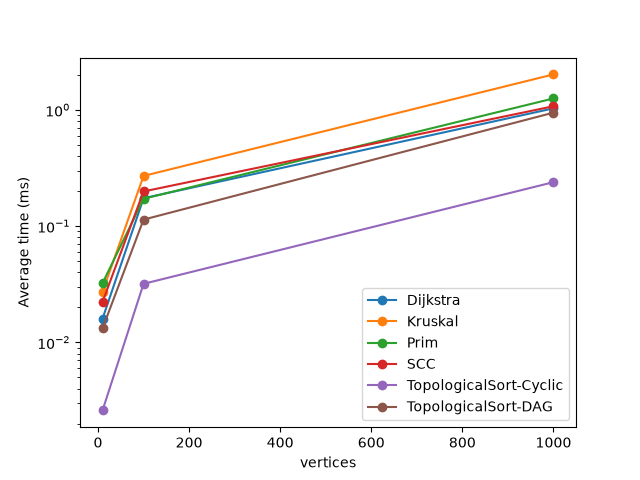
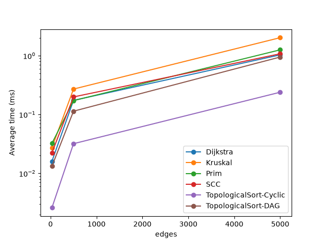

# Assignment 3 — Smart City Infrastructure and Route Planning

## Overview

This Java application models a smart city as a graph. Vertices are city districts and edges are roads or infrastructure connections. Weights are construction costs or distances.

The system supports three tasks:

- **Infrastructure planning:** Minimum Spanning Tree (Kruskal with DSU, Prim with a priority queue).
- **Connectivity analysis:** topological ordering and Strongly Connected Components (Kosaraju).
- **Route planning:** shortest paths with Dijkstra.

**Graph representation:** an adjacency list (`List<List<Edge>>`) plus a list of all edges. Vertices are numbered from 0, weights are integers. An undirected edge is stored in both adjacency lists.

## Implementation
src/
├── graph/          Edge, Graph, GraphGenerator
├── dsu/            DisjointSet
├── mst/            MstResult, KruskalMst, PrimMst
├── connectivity/   TopologicalSort, KosarajuScc
├── shortestpath/   VertexDistance, Dijkstra
├── experiments/    Main
└── tests/          AlgorithmTests

Main design decisions:

- **DSU:** `find` uses path compression, `union` uses union by rank. It counts `find` and `union` calls.
- **Kruskal:** sorts all edges by weight and adds an edge when `union` joins two different sets.
- **Prim:** starts at vertex 0 and uses a `PriorityQueue` of edges. A graph is connected when the MST has V - 1 edges.
- **Topological sort:** Kahn's algorithm (in-degrees and a queue). If fewer than V vertices are output, the graph has a cycle.
- **SCC:** Kosaraju's algorithm with two DFS passes, the second on the reversed graph.
- **Dijkstra:** a priority queue of (vertex, distance) pairs. Outdated queue entries are skipped. Unreachable vertices keep the distance `Integer.MAX_VALUE`. Negative weights throw an exception.

## Complexity Analysis

Assumptions: adjacency list, binary heap (`PriorityQueue`), V vertices, E edges.

| Algorithm | Time | Space |
|---|---|---|
| DSU `find` / `union` | O(α(V)) per operation, almost constant | O(V) |
| Kruskal | O(E log E) | O(V + E) |
| Prim | O(E log V) | O(V + E) |
| Topological sort | O(V + E) | O(V) |
| SCC (Kosaraju) | O(V + E) | O(V + E) |
| Dijkstra | O((V + E) log V) | O(V + E) |

- **DSU:** with path compression and union by rank, a sequence of operations costs almost constant time per operation (inverse Ackermann function α).
- **Kruskal:** sorting dominates, O(E log E). The DSU part is O(E α(V)). Performance depends mostly on E.
- **Prim:** each edge enters the heap at most once or twice, each heap operation costs O(log E) = O(log V). It grows with E, and V adds the visited array.
- **Topological sort:** every vertex is queued once and every edge is examined once.
- **SCC:** two DFS passes and one graph reversal, each O(V + E).
- **Dijkstra:** each edge can add one entry to the heap, each heap operation costs O(log V).

**Why Dijkstra fails with negative weights:** Dijkstra treats the distance of a vertex as final when the vertex leaves the queue. This is correct only if no later path can be shorter, which holds when all weights are non-negative. With a negative edge, a path found later can be shorter than a distance already finalized, so the result becomes wrong. For this reason the implementation rejects negative weights.

**How DSU optimizations help:** path compression makes every visited node point directly to the root, so trees become almost flat and later `find` calls are short. Union by rank attaches the smaller tree under the larger one, so trees cannot grow into long chains. Together they keep operations almost O(1).

## Experimental Setup

| Graph | Vertices (V) | Edges (E) |
|---|---|---|
| Small | 10 | 30 |
| Medium | 100 | 500 |
| Large | 1,000 | 5,000 |

- **Reproducibility:** every graph is generated with a fixed seed (`42`). Weights are random integers from 1 to 100. No duplicate edges and no self-loops.
- **Undirected graph (MST):** first a random spanning tree is built (each vertex is linked to an earlier vertex), so the graph is always connected. Then random edges are added until E is reached.
- **Directed graph (SCC, Dijkstra, cyclic topological sort):** random directed edges. This graph contains cycles.
- **DAG (topological sort):** random edges that always go from the smaller vertex number to the larger one, so it has no cycles.
- **Measurement:** each algorithm is run 5 times per graph, the average time is measured with `System.nanoTime()`.
- **Operations counted:**
    - Kruskal: edge examinations + DSU `find` calls + DSU `union` calls.
    - Prim: edge examinations + priority queue insertions and removals.
    - Topological sort and SCC: edge examinations.
    - Dijkstra: edge examinations + priority queue insertions and removals.

How to run:

javac -d out $(find src -name "*.java")
java -cp out experiments.Main
java -cp out tests.AlgorithmTests
python plot.py

## Results

Average time of 5 runs and operation counts (from `results/tables/results.csv`):

| Algorithm | V | E | Avg time (ms) | Operations |
|---|---|---|---|---|
| Kruskal | 10 | 30 | 0.0273 | 167 |
| Prim | 10 | 30 | 0.0323 | 120 |
| TopologicalSort-DAG | 10 | 30 | 0.0132 | 30 |
| TopologicalSort-Cyclic | 10 | 30 | 0.0026 | 0 |
| SCC | 10 | 30 | 0.0223 | 60 |
| Dijkstra | 10 | 30 | 0.0160 | 54 |
| Kruskal | 100 | 500 | 0.2703 | 2923 |
| Prim | 100 | 500 | 0.1720 | 2000 |
| TopologicalSort-DAG | 100 | 500 | 0.1138 | 500 |
| TopologicalSort-Cyclic | 100 | 500 | 0.0319 | 0 |
| SCC | 100 | 500 | 0.1988 | 1000 |
| Dijkstra | 100 | 500 | 0.1738 | 800 |
| Kruskal | 1000 | 5000 | 2.0201 | 29527 |
| Prim | 1000 | 5000 | 1.2545 | 20000 |
| TopologicalSort-DAG | 1000 | 5000 | 0.9469 | 5000 |
| TopologicalSort-Cyclic | 1000 | 5000 | 0.2389 | 54 |
| SCC | 1000 | 5000 | 1.0752 | 10000 |
| Dijkstra | 1000 | 5000 | 1.0312 | 7786 |

MST weights: Kruskal and Prim both gave 129 for Small, 1170 for Medium, 13123 for Large.

Number of SCCs in the directed graphs: 1 (Small), 1 (Medium), 18 (Large).

Plots (log scale on the time axis):

## Comparison and Discussion

- **Kruskal vs Prim:** both return the same MST weight on every graph. Compare their times and operation counts in the table above: Prim is faster on the large graph (~1.25 ms vs ~2.02 ms) and requires fewer operations (20,000 vs 29,527). Theory predicts similar behavior, since both are O(E log V) up to constants. Kruskal sorts all E edges first, Prim only pushes edges into the heap while growing the tree.
- **DSU:** the number of `find` and `union` calls is about 24,500 on the Large graph (29,527 total Kruskal ops minus 5,000 edge examinations), which stays close to a small multiple of E. This matches the almost constant cost per operation.
- **SCC:** runtime grows with the graph size. Going from Small to Large multiplies V by 100 and E by 166, the time grew by a factor of ~48 (from 0.02 ms to 1.07 ms). This is consistent with O(V + E).
- **Topological sort:** on DAGs the algorithm outputs all vertices. On the random directed graphs it stops early and reports a cycle, so it examines fewer edges. Compare: 5,000 operations for the Large DAG versus only 54 operations for the Large Cyclic graph.
- **Dijkstra:** operations grow with E and the heap size. Compare times across sizes: 0.016 ms (Small) -> 0.17 ms (Medium) -> 1.03 ms (Large). The growth is slightly faster than linear, which matches O((V + E) log V).
- **Theory vs experiment:** on Small graphs the times are very small and noisy (JVM start-up and JIT compilation). The larger the graph, the closer the measured growth is to the theoretical one.

## Testing

Tests are in `src/tests/AlgorithmTests.java` and run with a simple `check` method (PASS / FAIL output).

| Test case | What is verified |
|---|---|
| Small graph | Kruskal and Prim return weight 6 |
| Single vertex | MST weight 0, connected; topological order `[0]`; one SCC; Dijkstra distance 0 |
| Disconnected graph | both MST algorithms report "not connected" |
| Duplicate weights / multiple valid MSTs | both algorithms return weight 3 |
| Random graphs (10/30, 100/500, 1000/5000) | Kruskal and Prim weights are equal, graphs are connected |
| DAG | no cycle reported, order is valid for every edge |
| Graph with a cycle | topological sort reports a cycle |
| SCC | 2 components found, every vertex is in exactly one SCC |
| Dijkstra | correct distances and path, unreachable vertex detected, empty path for it |
| Negative weight | Dijkstra throws `IllegalArgumentException` |
| DSU | connected and separate elements, union of same set returns false |

Test output: Passed: 14, Failed: 0

## Conclusion

- **Kruskal** is simple and works well on sparse graphs or when the edges are already sorted. **Prim** works well on dense graphs with an adjacency list. Both give the same minimum cost.
- **DSU** with path compression and union by rank makes connectivity checks almost constant time.
- **Topological sort** is the right tool for dependencies between services, and it also detects cycles. **SCC** finds groups of locations that can reach each other, for example in one-way road networks.
- **Dijkstra** is the right choice for shortest routes with non-negative distances, but it cannot be used when weights are negative.
- All algorithms ran fast on graphs with 1,000 vertices and 5,000 edges, and the measured growth matched the theoretical complexity.